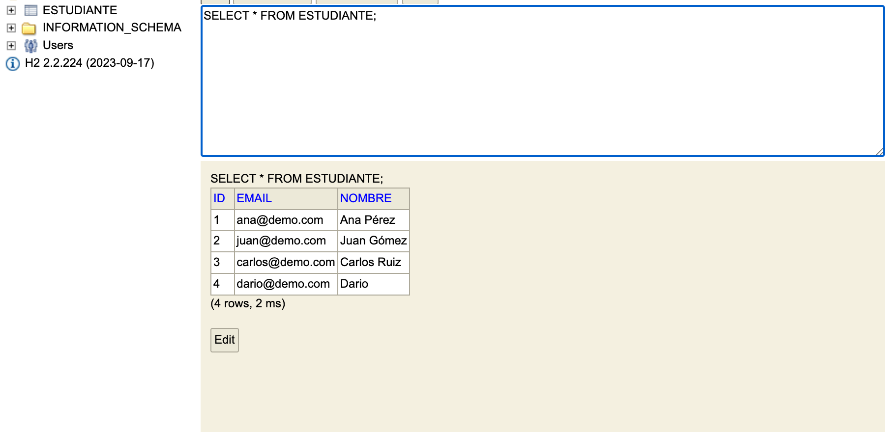

# Lab 01 — Módulo Estudiantes con arquitectura por capas

**Ingeniería de Software III** · Proyecto `lab01/` (Spring Boot 3.2.5 + Java 21 + H2 en memoria)

## Resumen

Se construyó el módulo **Estudiantes** del Sistema Académico sobre el proyecto base
`DemoAcademicoApplication`, aplicando arquitectura por capas (Controller → Service →
Repository → H2) y resolviendo los cinco puntos de la actividad en grupos:

| # | Actividad | Estado | Dónde |
|:--|:-------------------------------------------------|:-------|:------------------------------------|
| 1 | Endpoint de búsqueda por email | ✅ | `GET /api/estudiantes/buscar?email=...` |
| 2 | Manejo de error controlado por email duplicado | ✅ | `controller/GlobalExceptionHandler.java` → 409 |
| 3 | Documentar en comentarios a qué capa pertenece cada clase | ✅ | Javadoc de cabecera en las 7 clases |
| 4 | Captura de H2 Console con la tabla `estudiante` | ✅ | Sección 6 |
| 5 | Tres limitaciones del modelo por capas con evidencia | ✅ | Sección 8 |

---

## 1. Configuración

- **Java 21** (`openjdk 21.0.9`), **Maven 3.9**, **Spring Boot 3.2.5**.
- Dependencias: Web, Data JPA, H2 (runtime), Bean Validation, Test.
- `pom.xml` con `<java.version>21</java.version>` y `maven-compiler-plugin` en `source/target = 21`.

**`src/main/resources/application.yml`** (zona de conexión a la BD):

```yaml
spring:
  datasource:
    url: jdbc:h2:mem:demoacademico;DB_CLOSE_DELAY=-1;DB_CLOSE_ON_EXIT=FALSE
    driver-class-name: org.h2.Driver
    username: sa
    password:
  jpa:
    hibernate:
      ddl-auto: update
    show-sql: true
    # primero Hibernate crea la tabla, luego corre data.sql
    defer-datasource-initialization: true
  sql:
    init:
      mode: always
  h2:
    console:
      enabled: true
      path: /h2-console
```

URLs al arrancar:

- API: <http://localhost:8080/api/estudiantes>
- H2 Console: <http://localhost:8080/h2-console> — JDBC `jdbc:h2:mem:demoacademico`, user `sa`, password vacío.

---

## 2. Estructura y flujo por capas

```
co.edu.demoacademico
├── DemoAcademicoApplication.java
├── controller                          ← CAPA DE PRESENTACIÓN
│   ├── EstudianteController.java
│   └── GlobalExceptionHandler.java
├── service                             ← CAPA DE LÓGICA DE NEGOCIO
│   ├── EstudianteService.java
│   ├── EmailDuplicadoException.java
│   └── EstudianteNoEncontradoException.java
├── repository                          ← CAPA DE ACCESO A DATOS (zona BD)
│   └── EstudianteRepository.java
└── model                               ← MODELO / ENTIDAD
    └── Estudiante.java
```

### Diagrama del flujo

```
  Cliente (curl / Postman)
        │  HTTP  JSON
        ▼
┌──────────────────────────┐
│  PRESENTACIÓN            │  EstudianteController      @RestController
│  - mapea URL y verbos    │  GlobalExceptionHandler    @RestControllerAdvice
│  - valida con @Valid     │  (traduce excepción → HTTP 400/404/409)
│  - no tiene reglas       │
└───────────┬──────────────┘
            │  objetos Estudiante / excepciones
            ▼
┌──────────────────────────┐
│  LÓGICA DE NEGOCIO       │  EstudianteService         @Service
│  - regla: email único    │  → lanza EmailDuplicadoException
│  - no conoce HTTP        │  → lanza EstudianteNoEncontradoException
└───────────┬──────────────┘
            │  llamadas a métodos del repositorio
            ▼
┌──────────────────────────┐
│  ACCESO A DATOS  (BD)    │  EstudianteRepository      extends JpaRepository
│  - save / findAll        │  Spring Data genera el SQL
│  - findByEmail           │
│  - existsByEmail         │
└───────────┬──────────────┘
            │  JDBC / SQL
            ▼
┌──────────────────────────┐
│  H2 en memoria           │  tabla ESTUDIANTE  (+ data.sql de precarga)
└──────────────────────────┘
```

Cada clase lleva en el código un comentario de cabecera indicando su capa. Ejemplo:

```java
/**
 * CAPA: ACCESO A DATOS  <-- ZONA DE BASE DE DATOS
 *
 * Único punto del proyecto que habla con H2. Spring Data JPA genera la
 * implementación en tiempo de ejecución a partir de la firma de los métodos.
 */
@Repository
public interface EstudianteRepository extends JpaRepository<Estudiante, Long> { ... }
```

---

## 3. Implementación

### 3.1 Entidad — `model/Estudiante.java`

```java
@Entity
@Table(name = "estudiante")
public class Estudiante {

    @Id
    @GeneratedValue(strategy = GenerationType.IDENTITY)
    private Long id;

    @NotBlank(message = "El nombre es obligatorio")
    @Column(nullable = false)
    private String nombre;

    @NotBlank(message = "El email es obligatorio")
    @Email(message = "Formato de email inválido")
    @Column(nullable = false, unique = true)
    private String email;

    // constructores + getters/setters
}
```

### 3.2 Repositorio — `repository/EstudianteRepository.java` (zona BD)

```java
@Repository
public interface EstudianteRepository extends JpaRepository<Estudiante, Long> {

    // SELECT * FROM estudiante WHERE email = ?
    Optional<Estudiante> findByEmail(String email);

    // SELECT COUNT(*) > 0 FROM estudiante WHERE email = ?
    boolean existsByEmail(String email);
}
```

### 3.3 Servicio — `service/EstudianteService.java`

```java
@Service
public class EstudianteService {

    private final EstudianteRepository repository;

    public EstudianteService(EstudianteRepository repository) {
        this.repository = repository;
    }

    public Estudiante crear(Estudiante estudiante) {
        // ZONA DE LÓGICA DE NEGOCIO: email único
        if (repository.existsByEmail(estudiante.getEmail())) {
            throw new EmailDuplicadoException(estudiante.getEmail());
        }
        // ZONA DE ACCESO A LA BD
        return repository.save(estudiante);
    }

    public List<Estudiante> listar() {
        return repository.findAll();
    }

    public Estudiante buscarPorEmail(String email) {
        return repository.findByEmail(email)
                .orElseThrow(() -> new EstudianteNoEncontradoException(email));
    }
}
```

### 3.4 Controlador — `controller/EstudianteController.java`

```java
@RestController
@RequestMapping("/api/estudiantes")
public class EstudianteController {

    private final EstudianteService service;

    public EstudianteController(EstudianteService service) { this.service = service; }

    @PostMapping
    @ResponseStatus(HttpStatus.CREATED)
    public Estudiante crear(@Valid @RequestBody Estudiante estudiante) {
        return service.crear(estudiante);
    }

    @GetMapping
    public List<Estudiante> listar() { return service.listar(); }

    // Actividad 1: GET /api/estudiantes/buscar?email=ana@demo.com
    @GetMapping("/buscar")
    public Estudiante buscarPorEmail(@RequestParam String email) {
        return service.buscarPorEmail(email);
    }
}
```

### 3.5 Manejo de error controlado — `controller/GlobalExceptionHandler.java`

Actividad 2: el cliente recibe un JSON claro en vez de un stacktrace o un 500 genérico.

```java
@RestControllerAdvice
public class GlobalExceptionHandler {

    @ExceptionHandler(EmailDuplicadoException.class)
    public ResponseEntity<Map<String, Object>> handleEmailDuplicado(
            EmailDuplicadoException ex) {
        return ResponseEntity.status(HttpStatus.CONFLICT)
                .body(errorBody(HttpStatus.CONFLICT, ex.getMessage()));
    }

    @ExceptionHandler(EstudianteNoEncontradoException.class)
    public ResponseEntity<Map<String, Object>> handleNoEncontrado(
            EstudianteNoEncontradoException ex) {
        return ResponseEntity.status(HttpStatus.NOT_FOUND)
                .body(errorBody(HttpStatus.NOT_FOUND, ex.getMessage()));
    }

    @ExceptionHandler(MethodArgumentNotValidException.class)
    public ResponseEntity<Map<String, Object>> handleValidacion(
            MethodArgumentNotValidException ex) {
        // devuelve 400 con el detalle campo por campo
    }
}
```

---

## 4. Precarga de datos — `src/main/resources/data.sql`

```sql
INSERT INTO estudiante (nombre, email) VALUES ('Ana Pérez', 'ana@demo.com');
INSERT INTO estudiante (nombre, email) VALUES ('Juan Gómez', 'juan@demo.com');
INSERT INTO estudiante (nombre, email) VALUES ('Carlos Ruiz', 'carlos@demo.com');
```

Log de arranque (Hibernate crea la tabla antes de que corra `data.sql`, gracias a
`defer-datasource-initialization: true`):

```
Hibernate:
    create table estudiante (
        id bigint generated by default as identity,
        email varchar(255) not null,
        nombre varchar(255) not null,
        primary key (id)
    )
Hibernate:
    alter table if exists estudiante
       add constraint UK_tbc5806vbo6w5mcbmkqom1m0n unique (email)
```

---

## 5. Evidencias de ejecución (curl)

Todas ejecutadas contra la aplicación corriendo en `localhost:8080`.

### 5.1 Listar (los 3 registros de `data.sql`)

```console
$ curl http://localhost:8080/api/estudiantes
[{"id":1,"nombre":"Ana Pérez","email":"ana@demo.com"},
 {"id":2,"nombre":"Juan Gómez","email":"juan@demo.com"},
 {"id":3,"nombre":"Carlos Ruiz","email":"carlos@demo.com"}]
[HTTP 200]
```

### 5.2 Crear estudiante

```console
$ curl -X POST http://localhost:8080/api/estudiantes \
    -H "Content-Type: application/json" \
    -d '{"nombre":"Dario","email":"dario@demo.com"}'
{"id":4,"nombre":"Dario","email":"dario@demo.com"}
[HTTP 201]
```

### 5.3 Regla de negocio: email único (error controlado)

```console
$ curl -X POST http://localhost:8080/api/estudiantes \
    -H "Content-Type: application/json" \
    -d '{"nombre":"Otro Dario","email":"dario@demo.com"}'
{"timestamp":"2026-09-16T23:11:51.820093Z",
 "status":409,
 "error":"Conflict",
 "message":"Ya existe un estudiante con el email: dario@demo.com"}
[HTTP 409]
```

### 5.4 Búsqueda por email — encontrado

```console
$ curl "http://localhost:8080/api/estudiantes/buscar?email=ana@demo.com"
{"id":1,"nombre":"Ana Pérez","email":"ana@demo.com"}
[HTTP 200]
```

### 5.5 Búsqueda por email — no encontrado

```console
$ curl "http://localhost:8080/api/estudiantes/buscar?email=noexiste@demo.com"
{"timestamp":"2026-09-16T23:11:51.862674Z",
 "status":404,
 "error":"Not Found",
 "message":"No se encontró un estudiante con el email: noexiste@demo.com"}
[HTTP 404]
```

### 5.6 Validaciones de Bean Validation

```console
$ curl -X POST http://localhost:8080/api/estudiantes \
    -H "Content-Type: application/json" \
    -d '{"nombre":"","email":"no-es-email"}'
{"timestamp":"2026-09-16T23:11:51.882626Z",
 "status":400,
 "error":"Bad Request",
 "message":"Validación inválida",
 "campos":{"nombre":"El nombre es obligatorio","email":"Formato de email inválido"}}
[HTTP 400]
```

### 5.7 Resumen de endpoints

| Método | Ruta | Éxito | Error |
|:-------|:---------------------------------|:------------|:------------------------------------|
| `POST` | `/api/estudiantes` | 201 Created | 409 email duplicado · 400 validación |
| `GET` | `/api/estudiantes` | 200 OK | — |
| `GET` | `/api/estudiantes/buscar?email=` | 200 OK | 404 no encontrado |

---

## 6. Captura de H2 Console

Conexión: `jdbc:h2:mem:demoacademico`, usuario `sa`, sin password. Consulta ejecutada:
`SELECT * FROM ESTUDIANTE;`



Se observan los **3 registros precargados por `data.sql`** más el **estudiante creado por POST**
(`id 4`, `dario@demo.com`), lo que confirma que el flujo Controller → Service → Repository
llega efectivamente a la base de datos: 4 filas en total.

---

## 7. Clasificación de las clases por capa

| Clase | Capa | Responsabilidad |
|:--------------------------------|:-----------------|:-----------------------------------------|
| `EstudianteController` | **Presentación** | Expone endpoints REST, valida la entrada con `@Valid`, delega en el Service |
| `GlobalExceptionHandler` | **Presentación** | Traduce excepciones de negocio a códigos HTTP y JSON de error |
| `EstudianteService` | **Lógica de negocio** | Regla de email único, orquesta las llamadas al repositorio |
| `EmailDuplicadoException` | **Lógica de negocio** | Señala la violación de la regla de negocio |
| `EstudianteNoEncontradoException` | **Lógica de negocio** | Señala una búsqueda sin resultados |
| `EstudianteRepository` | **Acceso a datos (zona BD)** | Única frontera con H2; Spring Data genera el SQL |
| `Estudiante` | **Modelo** | Entidad JPA; atraviesa las tres capas |

---

## 8. Limitaciones observadas del modelo por capas

### Limitación 1 — La entidad de base de datos es también el contrato de la API

`Estudiante` cumple dos papeles incompatibles a la vez: es la tabla de H2 y es el JSON que
entra y sale por HTTP.

```java
// model/Estudiante.java — anotaciones de persistencia Y de validación de entrada
@Entity @Table(name = "estudiante")          // ← infraestructura (BD)
public class Estudiante {
    @NotBlank @Email                          // ← contrato de la API
    @Column(nullable = false, unique = true)  // ← infraestructura (BD)
    private String email;
}
```

```java
// controller/EstudianteController.java — la entidad entra directo desde el request
public Estudiante crear(@Valid @RequestBody Estudiante estudiante) { ... }
```

**Consecuencias observadas:**

- Cualquier cambio de esquema (renombrar una columna, agregar `promedio`, `activo`) **rompe o
  altera la API** sin que nadie lo decida explícitamente.
- No se puede ocultar un campo interno ni exponer uno calculado: lo que hay en la tabla es lo
  que ve el cliente.
- El cliente puede enviar `{"id": 99, ...}` en el POST porque `id` forma parte del cuerpo aceptado.

*(En el Lab 02 esto se corrigió introduciendo `EstudianteCreateDTO` / `EstudianteDTO`.)*

---

### Limitación 2 — La lógica de negocio depende de la infraestructura, no al revés

El servicio —que debería ser la parte más estable del sistema— importa y depende de una
interfaz de Spring Data JPA:

```java
// service/EstudianteService.java
import co.edu.demoacademico.repository.EstudianteRepository;  // ← extends JpaRepository

private final EstudianteRepository repository;                // dependencia hacia la BD

public Estudiante crear(Estudiante estudiante) {
    if (repository.existsByEmail(estudiante.getEmail())) { ... }
}
```

La flecha de dependencia apunta **de negocio hacia infraestructura**, exactamente al contrario
de lo que buscan las arquitecturas limpias/hexagonales.

**Consecuencias observadas:**

- No se puede probar la regla "email único" sin arrastrar JPA: hay que **mockear** una interfaz
  de Spring Data o levantar el contexto completo (`@SpringBootTest` + H2), lo que convierte un
  test que debería ser unitario en un test de integración lento.
- Cambiar de H2 a otro motor, o de JPA a JDBC/Mongo, **obliga a tocar el paquete `service`**,
  aunque la regla de negocio no haya cambiado ni una línea.
- No existe una interfaz `EstudianteRepository` propia del dominio: el dominio habla el idioma
  del framework (`Optional<Estudiante> findByEmail`, `JpaRepository<Estudiante, Long>`).

---

### Limitación 3 — La regla de negocio está repartida en tres capas, y eso abre un hueco real

La unicidad del email vive simultáneamente en:

| Capa | Dónde | Forma |
|------|-------|-------|
| Modelo/BD | `Estudiante.email` | `@Column(unique = true)` → constraint `UK_tbc5806...` |
| Negocio | `EstudianteService.crear` | `if (repository.existsByEmail(...)) throw ...` |
| Presentación | `GlobalExceptionHandler` | `EmailDuplicadoException → 409` |

Ninguna de las tres es "la" regla: es la suma de las tres. Y entre la verificación del servicio y
el `save` del repositorio hay una ventana en la que la regla **no se cumple**, porque
`existsByEmail` + `save` no son una operación atómica:

```java
if (repository.existsByEmail(estudiante.getEmail())) {   // ← hilo A y hilo B pasan los dos
    throw new EmailDuplicadoException(...);
}
return repository.save(estudiante);                      // ← uno de los dos revienta en la BD
```

**Comprobación empírica** — 30 peticiones `POST` concurrentes con el mismo email nuevo:

```console
$ for i in $(seq 1 30); do curl -s -o /dev/null -w "%{http_code}\n" \
    -X POST http://localhost:8080/api/estudiantes \
    -H "Content-Type: application/json" \
    -d '{"nombre":"Race Test","email":"race@demo.com"}' & done; wait

   1  201   ← el que ganó
  20  409   ← rechazados correctamente por el Service
   9  500   ← pasaron la validación del Service y chocaron contra la BD
```

El cuerpo que recibe el cliente en esos casos no es el JSON claro del handler, sino el error
por defecto de Spring, sin mensaje:

```json
{"timestamp":"2026-09-16T23:13:41.622+00:00","status":500,
 "error":"Internal Server Error","path":"/api/estudiantes"}
```

Y en el log aparece el error crudo de la capa de datos:

```
org.springframework.dao.DataIntegrityViolationException:
  ... Unique index or primary key violation:
  "PUBLIC.UK_TBC5806VBO6W5MCBMKQOM1M0N_INDEX_8 ON PUBLIC.ESTUDIANTE(EMAIL NULLS FIRST)
   VALUES ( 'race@demo.com' )"; SQL statement:
  insert into estudiante (email,nombre,id) values (?,?,default) [23505-224]
```

**Consecuencias observadas:**

- La misma violación de negocio produce **dos respuestas distintas** (409 o 500) según el momento
  en que ocurra: el comportamiento del sistema depende de en qué capa se detecte el problema.
- El "parche" natural es capturar `DataIntegrityViolationException` en el
  `GlobalExceptionHandler` y devolver 409 — pero eso obliga a la **capa de presentación a conocer
  una excepción de Spring/JDBC**, es decir, a acoplarse a la infraestructura para tapar un hueco
  que nació de la separación en capas. Se decidió **no aplicar ese parche en el Lab 01** para
  conservar la evidencia.
- La regla no es verificable en un solo lugar: hay que leer tres archivos —y el log de Hibernate—
  para saber qué hace realmente el sistema cuando un email se repite.

---

## 9. Cómo ejecutar

```bash
cd lab01
mvn spring-boot:run
```

- API: <http://localhost:8080/api/estudiantes>
- H2 Console: <http://localhost:8080/h2-console> (JDBC `jdbc:h2:mem:demoacademico`, user `sa`, sin password)

Compilar y correr las pruebas:

```bash
cd lab01
mvn clean package
```

---

## 10. Cierre

El modelo por capas permitió tener el módulo funcionando muy rápido y con responsabilidades
legibles, pero las tres limitaciones documentadas apuntan al mismo punto: **la lógica de negocio
no está protegida**, depende del framework de persistencia y se filtra hacia la entidad, hacia el
repositorio y hacia el manejador de errores. Esa es justamente la motivación de la siguiente etapa
del curso, donde la arquitectura se reorganiza para que la infraestructura dependa del dominio y
no al contrario.
