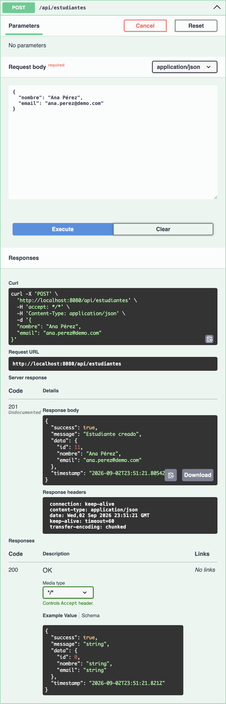
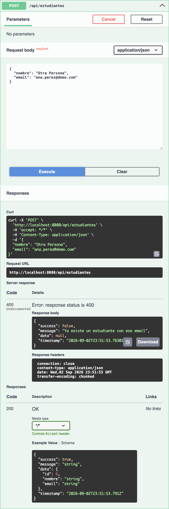

# Lab 02 — Evolución del módulo Estudiantes

**Ingeniería de Software III**

## Declaración

> **Implementé la Opción A y la Opción B.**

Se construyeron dos proyectos Spring Boot 3.3.4 + Java 21 independientes (comparten el paquete `co.edu.demoacademico`, por eso viven en carpetas hermanas):

| Carpeta | Opción | Enfoque |
|---------|--------|---------|
| `lab02/` | **A** | DTO + `ApiResponse<T>` + `ResponseBuilder` + `Handler` de mapeo DTO <-> Entity |
| `lab02-b/` | **B** | Entity directo + excepciones propias + `Map` en el `GlobalExceptionHandler` |

Ambas versiones cumplen la regla de negocio de email único, paginación con `Pageable`, seeder con Faker controlado por `app.seed.*`, y manejo global de errores (sin stacktrace).

---

## 1. Configuración

- Java 21, Spring Boot 3.3.4, JPA + H2 en memoria, Bean Validation, springdoc-openapi 2.6.0, javafaker 1.0.2.
- URLs comunes al arrancar:
  - Swagger UI: http://localhost:8080/swagger-ui.html
  - H2 Console: http://localhost:8080/h2-console (JDBC: `jdbc:h2:mem:demoacademico`, user `sa`, sin password)
- Configuración de seed en `application.yml`:

```yaml
app:
  seed:
    enabled: true
    cantidad: 500
```

---

## 2. Estructura del proyecto

### Opción A (`lab02/`)

```
co.edu.demoacademico
├── DemoAcademicoApplication.java
├── api
│   ├── ApiResponse.java
│   └── ResponseBuilder.java
├── config
│   └── DataSeeder.java
├── controller
│   ├── EstudianteController.java
│   └── GlobalExceptionHandler.java
├── dto
│   ├── EstudianteCreateDTO.java
│   ├── EstudianteUpdateDTO.java
│   └── EstudianteDTO.java
├── exception
│   ├── BusinessException.java
│   └── NotFoundException.java
├── handler
│   └── EstudianteHandler.java
├── model
│   └── Estudiante.java
├── repository
│   └── EstudianteRepository.java
└── service
    ├── EstudianteService.java
    └── EstudianteServiceImpl.java
```

### Opción B (`lab02-b/`)

```
co.edu.demoacademico
├── DemoAcademicoApplication.java
├── config
│   └── DataSeeder.java
├── controller
│   ├── EstudianteController.java
│   └── GlobalExceptionHandler.java
├── model
│   └── Estudiante.java
├── repository
│   └── EstudianteRepository.java
└── service
    ├── EstudianteService.java
    ├── EmailDuplicadoException.java
    └── EstudianteNoEncontradoException.java
```

---

## 3. Código clave

Se muestran los archivos que implementan las decisiones de diseño más importantes de cada opción. El código completo está en las carpetas `lab02/` y `lab02-b/`.

### 3.1 Entidad (idéntica en A y B)

**`src/main/java/co/edu/demoacademico/model/Estudiante.java`**

```java
package co.edu.demoacademico.model;

import jakarta.persistence.*;
import jakarta.validation.constraints.Email;
import jakarta.validation.constraints.NotBlank;

@Entity
@Table(name = "estudiante")
public class Estudiante {

    @Id
    @GeneratedValue(strategy = GenerationType.IDENTITY)
    private Long id;

    @NotBlank(message = "El nombre es obligatorio")
    @Column(nullable = false)
    private String nombre;

    @NotBlank(message = "El email es obligatorio")
    @Email(message = "Formato de email inválido")
    @Column(nullable = false, unique = true)
    private String email;

    public Estudiante() {}
    public Estudiante(String nombre, String email) { this.nombre = nombre; this.email = email; }
    public Long getId() { return id; } public void setId(Long id) { this.id = id; }
    public String getNombre() { return nombre; } public void setNombre(String nombre) { this.nombre = nombre; }
    public String getEmail() { return email; } public void setEmail(String email) { this.email = email; }
}
```

### 3.2 Seeder con Faker (idéntico en A y B)

**`src/main/java/co/edu/demoacademico/config/DataSeeder.java`**

```java
package co.edu.demoacademico.config;

import co.edu.demoacademico.model.Estudiante;
import co.edu.demoacademico.repository.EstudianteRepository;
import com.github.javafaker.Faker;
import org.springframework.beans.factory.annotation.Value;
import org.springframework.boot.CommandLineRunner;
import org.springframework.context.annotation.Bean;
import org.springframework.context.annotation.Configuration;
import java.util.Locale;

@Configuration
public class DataSeeder {

    @Value("${app.seed.enabled:true}")   private boolean enabled;
    @Value("${app.seed.cantidad:100}")   private int cantidad;

    @Bean
    CommandLineRunner seedEstudiantes(EstudianteRepository repo) {
        return args -> {
            if (!enabled) return;
            if (repo.count() > 0) return;
            Faker faker = new Faker(new Locale("es"));
            int creados = 0;
            while (creados < cantidad) {
                String nombre = faker.name().fullName();
                String email = ("est" + creados + "_" + faker.internet().emailAddress())
                        .toLowerCase().replace(" ", "").replace("..", ".");
                Estudiante e = new Estudiante();
                e.setNombre(nombre); e.setEmail(email);
                try { repo.save(e); creados++; } catch (Exception ex) { /* email único: reintenta */ }
            }
        };
    }
}
```

### 3.3 Opción A — servicio con la regla de negocio (email único)

**`lab02/src/main/java/co/edu/demoacademico/service/EstudianteServiceImpl.java`**

```java
@Service
@Transactional
public class EstudianteServiceImpl implements EstudianteService {

    private final EstudianteRepository repo;
    public EstudianteServiceImpl(EstudianteRepository repo) { this.repo = repo; }

    @Override
    public Estudiante crear(Estudiante e) {
        if (repo.existsByEmail(e.getEmail())) {
            throw new BusinessException("Ya existe un estudiante con ese email");
        }
        return repo.save(e);
    }

    @Override @Transactional(readOnly = true)
    public Estudiante obtenerPorId(Long id) {
        return repo.findById(id)
                .orElseThrow(() -> new NotFoundException("Estudiante no encontrado: " + id));
    }

    @Override @Transactional(readOnly = true)
    public Page<Estudiante> listar(Pageable pageable) { return repo.findAll(pageable); }

    @Override
    public Estudiante actualizar(Long id, Estudiante e) {
        Estudiante actual = obtenerPorId(id);
        if (repo.existsByEmailAndIdNot(e.getEmail(), id)) {
            throw new BusinessException("El email ya lo usa otro estudiante");
        }
        actual.setNombre(e.getNombre()); actual.setEmail(e.getEmail());
        return repo.save(actual);
    }

    @Override
    public void eliminar(Long id) { repo.delete(obtenerPorId(id)); }
}
```

### 3.4 Opción A — Controller (DTOs + ApiResponse + Pageable)

**`lab02/src/main/java/co/edu/demoacademico/controller/EstudianteController.java`**

```java
@RestController
@RequestMapping("/api/estudiantes")
public class EstudianteController {

    private final EstudianteHandler handler;
    public EstudianteController(EstudianteHandler handler) { this.handler = handler; }

    @PostMapping
    public ResponseEntity<ApiResponse<EstudianteDTO>> crear(@Valid @RequestBody EstudianteCreateDTO in) {
        return ResponseBuilder.created("Estudiante creado", handler.crear(in));
    }

    @GetMapping("/{id}")
    public ResponseEntity<ApiResponse<EstudianteDTO>> obtener(@PathVariable Long id) {
        return ResponseBuilder.ok("OK", handler.obtener(id));
    }

    @GetMapping
    public ResponseEntity<ApiResponse<Page<EstudianteDTO>>> listar(@ParameterObject Pageable pageable) {
        return ResponseBuilder.ok("OK", handler.listar(pageable));
    }

    @PutMapping("/{id}")
    public ResponseEntity<ApiResponse<EstudianteDTO>> actualizar(
            @PathVariable Long id, @Valid @RequestBody EstudianteUpdateDTO in) {
        return ResponseBuilder.ok("Estudiante actualizado", handler.actualizar(id, in));
    }

    @DeleteMapping("/{id}")
    public ResponseEntity<ApiResponse<Object>> eliminar(@PathVariable Long id) {
        handler.eliminar(id);
        return ResponseBuilder.ok("Estudiante eliminado", null);
    }
}
```

### 3.5 Opción A — Manejador global de errores

**`lab02/src/main/java/co/edu/demoacademico/controller/GlobalExceptionHandler.java`**

```java
@RestControllerAdvice
public class GlobalExceptionHandler {

    @ExceptionHandler(NotFoundException.class)
    public ResponseEntity<ApiResponse<Object>> handleNotFound(NotFoundException ex) {
        return ResponseBuilder.notFound(ex.getMessage());
    }

    @ExceptionHandler(BusinessException.class)
    public ResponseEntity<ApiResponse<Object>> handleBusiness(BusinessException ex) {
        return ResponseBuilder.badRequest(ex.getMessage());
    }

    @ExceptionHandler(MethodArgumentNotValidException.class)
    public ResponseEntity<ApiResponse<Map<String, String>>> handleValidation(MethodArgumentNotValidException ex) {
        Map<String, String> errors = new HashMap<>();
        ex.getBindingResult().getFieldErrors()
                .forEach(fe -> errors.put(fe.getField(), fe.getDefaultMessage()));
        return ResponseEntity.badRequest()
                .body(new ApiResponse<>(false, "Validación fallida", errors));
    }

    @ExceptionHandler(Exception.class)
    public ResponseEntity<ApiResponse<Object>> handleGeneric(Exception ex) {
        return ResponseBuilder.internalError("Error inesperado");
    }
}
```

### 3.6 Opción B — Service con excepciones propias

**`lab02-b/src/main/java/co/edu/demoacademico/service/EstudianteService.java`**

```java
@Service
public class EstudianteService {

    private final EstudianteRepository repository;
    public EstudianteService(EstudianteRepository repository) { this.repository = repository; }

    public Estudiante crear(Estudiante estudiante) {
        if (repository.existsByEmail(estudiante.getEmail())) {
            throw new EmailDuplicadoException(estudiante.getEmail());
        }
        return repository.save(estudiante);
    }

    public List<Estudiante> listar() { return repository.findAll(); }

    public Page<Estudiante> listar(Pageable pageable) { return repository.findAll(pageable); }

    public Estudiante buscarPorEmail(String email) {
        return repository.findByEmail(email)
                .orElseThrow(() -> new EstudianteNoEncontradoException(email));
    }
}
```

### 3.7 Opción B — Handler global (Map + status 409 en duplicado)

**`lab02-b/src/main/java/co/edu/demoacademico/controller/GlobalExceptionHandler.java`**

```java
@RestControllerAdvice
public class GlobalExceptionHandler {

    @ExceptionHandler(EmailDuplicadoException.class)
    public ResponseEntity<Map<String, Object>> handleEmailDuplicado(EmailDuplicadoException ex) {
        return ResponseEntity.status(HttpStatus.CONFLICT).body(errorBody(HttpStatus.CONFLICT, ex.getMessage()));
    }

    @ExceptionHandler(EstudianteNoEncontradoException.class)
    public ResponseEntity<Map<String, Object>> handleNoEncontrado(EstudianteNoEncontradoException ex) {
        return ResponseEntity.status(HttpStatus.NOT_FOUND).body(errorBody(HttpStatus.NOT_FOUND, ex.getMessage()));
    }

    @ExceptionHandler(MethodArgumentNotValidException.class)
    public ResponseEntity<Map<String, Object>> handleValidacion(MethodArgumentNotValidException ex) {
        Map<String, String> fields = new HashMap<>();
        for (FieldError fe : ex.getBindingResult().getFieldErrors()) {
            fields.put(fe.getField(), fe.getDefaultMessage());
        }
        Map<String, Object> body = errorBody(HttpStatus.BAD_REQUEST, "Validación inválida");
        body.put("fields", fields);
        return ResponseEntity.status(HttpStatus.BAD_REQUEST).body(body);
    }

    @ExceptionHandler(Exception.class)
    public ResponseEntity<Map<String, Object>> handleGeneral(Exception ex) {
        return ResponseEntity.status(HttpStatus.INTERNAL_SERVER_ERROR)
                .body(errorBody(HttpStatus.INTERNAL_SERVER_ERROR, "Error inesperado"));
    }

    private Map<String, Object> errorBody(HttpStatus status, String message) {
        Map<String, Object> body = new HashMap<>();
        body.put("timestamp", Instant.now().toString());
        body.put("status", status.value());
        body.put("error", status.getReasonPhrase());
        body.put("message", message);
        return body;
    }
}
```

---

## 4. Cómo ejecutar (no ambos a la vez — comparten el puerto 8080)

```bash
# Opción A
mvn -f lab02/pom.xml spring-boot:run

# Opción B
mvn -f lab02-b/pom.xml spring-boot:run
```

Al arrancar cada app, en los logs se ve:

```
Tomcat started on port 8080 (http) with context path '/'
Started DemoAcademicoApplication in 2.4 seconds
Hibernate: create table estudiante (id bigint generated by default as identity, email varchar(255) not null, nombre varchar(255) not null, primary key (id))
Hibernate: alter table if exists estudiante add constraint UKtbc5806vbo6w5mcbmkqom1m0n unique (email)
Hibernate: select count(*) from estudiante e1_0
Hibernate: insert into estudiante (email, nombre, id) values (?, ?, default)   -- x N (seeder)
```

Nota la restricción `unique (email)` sobre la columna `email`, aplicada automáticamente por JPA a partir del `@Column(unique = true)`.

---

## 5. Evidencia de pruebas (equivalentes a probar en Swagger UI)

Todas las pruebas se ejecutaron contra http://localhost:8080 con `app.seed.cantidad=10`. Los mismos endpoints están expuestos en Swagger (`/swagger-ui.html`) y responden idéntico si se prueban desde ahí.

### 5.1 Opción A

#### Prueba exitosa — crear estudiante válido (`POST /api/estudiantes`)

Body enviado:

```json
{"nombre":"Ana Pérez","email":"ana.perez@demo.com"}
```

Respuesta:

```
HTTP 201
{"success":true,"message":"Estudiante creado","data":{"id":11,"nombre":"Ana Pérez","email":"ana.perez@demo.com"},"timestamp":"2026-09-02T23:51:21.805422Z"}
```

**Captura de Swagger UI:**

{ height=85% }

#### Prueba exitosa adicional — listado paginado (`GET /api/estudiantes?page=0&size=3&sort=nombre,asc`)

```
HTTP 200
{
  "success": true,
  "message": "OK",
  "data": {
    "content": [
      {"id":11,"nombre":"Ana Pérez","email":"ana.perez@demo.com"},
      {"id":4,"nombre":"Elsa Iglesias Luna","email":"est3_marilu.prieto@gmail.com"},
      {"id":10,"nombre":"Florencia Ponce Cabrera","email":"est9_cristina.barajas@hotmail.com"}
    ],
    "totalPages": 4,
    "totalElements": 11,
    "size": 3,
    "number": 0,
    "first": true,
    "last": false
  },
  "timestamp": "2026-09-02T23:34:49.557112Z"
}
```

#### Prueba con error controlado — validación de email inválido

Body enviado:

```json
{"nombre":"Sin Email","email":"no-es-email"}
```

Respuesta:

```
HTTP 400
{"success":false,"message":"Validación fallida","data":{"email":"Formato de email inválido"},"timestamp":"2026-09-02T23:34:18.605731Z"}
```

#### Prueba con error controlado — email duplicado (regla de negocio)

Body enviado (email ya existe):

```json
{"nombre":"Otra Persona","email":"ana.perez@demo.com"}
```

Respuesta:

```
HTTP 400
{"success":false,"message":"Ya existe un estudiante con ese email","data":null,"timestamp":"2026-09-02T23:51:53.763012Z"}
```

**Captura de Swagger UI:**

{ height=85% }

#### Prueba con error controlado — recurso no encontrado (`GET /api/estudiantes/999999`)

```
HTTP 404
{"success":false,"message":"Estudiante no encontrado: 999999","data":null,"timestamp":"2026-09-02T23:34:18.649979Z"}
```

---

### 5.2 Opción B

#### Prueba exitosa — crear estudiante válido (`POST /api/estudiantes`)

Body enviado:

```json
{"nombre":"Ana Pérez","email":"ana.perez@demo.com"}
```

Respuesta:

```
HTTP 200
{"id":11,"nombre":"Ana Pérez","email":"ana.perez@demo.com"}
```

#### Prueba exitosa adicional — listado paginado (`GET /api/estudiantes/pagina?page=0&size=3&sort=nombre,asc`)

```
HTTP 200
{
  "content": [
    {"id":6,"nombre":"Alicia Caballero Gonzales","email":"est5_irene.muniz@yahoo.com"},
    {"id":11,"nombre":"Ana Pérez","email":"ana.perez@demo.com"},
    {"id":10,"nombre":"Benjamín Soria Lozano","email":"est9_adela.pineda@gmail.com"}
  ],
  "totalElements": 11,
  "totalPages": 4,
  "size": 3,
  "number": 0,
  "first": true,
  "last": false
}
```

#### Prueba con error controlado — validación de email inválido

Body enviado:

```json
{"nombre":"Sin Email","email":"no-es-email"}
```

Respuesta:

```
HTTP 400
{"error":"Bad Request","message":"Validación inválida","fields":{"email":"Formato de email inválido"},"timestamp":"2026-09-02T23:41:03.576800Z","status":400}
```

#### Prueba con error controlado — email duplicado (`EmailDuplicadoException` -> 409 Conflict)

Body enviado (email ya existe):

```json
{"nombre":"Otro","email":"ana.perez@demo.com"}
```

Respuesta:

```
HTTP 409
{"error":"Conflict","message":"Ya existe un estudiante con el email: ana.perez@demo.com","timestamp":"2026-09-02T23:41:03.596541Z","status":409}
```

#### Prueba con error controlado — buscar por email inexistente (`GET /api/estudiantes/buscar?email=no-existe@demo.com`)

```
HTTP 404
{"error":"Not Found","message":"No se encontró estudiante con el email: no-existe@demo.com","timestamp":"2026-09-02T23:41:03.657624Z","status":404}
```

---

## 6. Cómo reproducir en Swagger UI

1. Arrancar la app (`mvn -f lab02/pom.xml spring-boot:run` o `lab02-b`).
2. Abrir http://localhost:8080/swagger-ui.html.
3. Expandir `estudiante-controller` -> **POST /api/estudiantes** -> *Try it out* -> pegar el body de la prueba deseada -> *Execute*.
4. Para paginación, expandir el **GET** paginado y usar los parámetros `page`, `size`, `sort` (`nombre,asc`).
5. Verificar en la sección *Server response* que el código HTTP y el JSON coinciden con las evidencias de arriba.

---

## 7. Checklist final

- [x] Regla de email único aplicada (a nivel de servicio con `existsByEmail` y a nivel de BD con `@Column(unique = true)`).
- [x] Paginación con `Pageable` funcional (A: `GET /api/estudiantes?page=...`, B: `GET /api/estudiantes/pagina?page=...`).
- [x] Respuestas de error controladas (nunca stacktrace). Validación, negocio, not found y error genérico manejados en `GlobalExceptionHandler`.
- [x] Seeder con Faker funcionando controlado por `app.seed.enabled` y `app.seed.cantidad`; solo inserta si la tabla está vacía.
- [x] Pruebas verificadas contra los endpoints (equivalentes a Swagger UI).
- [x] Se documenta la opción implementada.

---

## 8. Diferencias clave entre A y B (resumen comparativo)

| Aspecto | Opción A | Opción B |
|---------|----------|----------|
| Contrato de respuesta | `ApiResponse<T>` (`success`, `message`, `data`, `timestamp`) | Entidad directa (`Estudiante`) |
| Separación entidad/API | Sí — DTO + Handler | No — el Controller expone la Entity |
| Email inválido | 400 con `data: {email: "..."}` | 400 con `fields: {email: "..."}` + `status`/`error` |
| Email duplicado | **400** `BusinessException` | **409 Conflict** `EmailDuplicadoException` |
| No encontrado | 404 con `success:false` | 404 con `status`/`error`/`message` |
| Ruta paginada | `GET /api/estudiantes?page=...` | `GET /api/estudiantes/pagina?page=...` |
| Búsqueda | por id: `GET /api/estudiantes/{id}` | por email: `GET /api/estudiantes/buscar?email=...` |

---

**Implementé la Opción A y la Opción B.**
